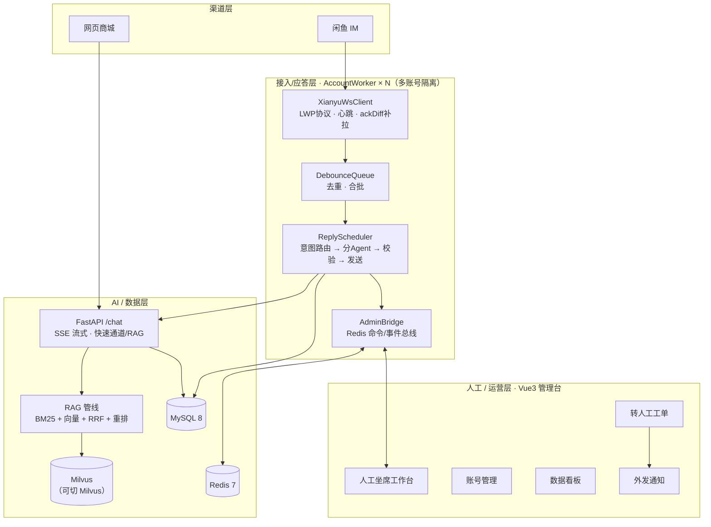
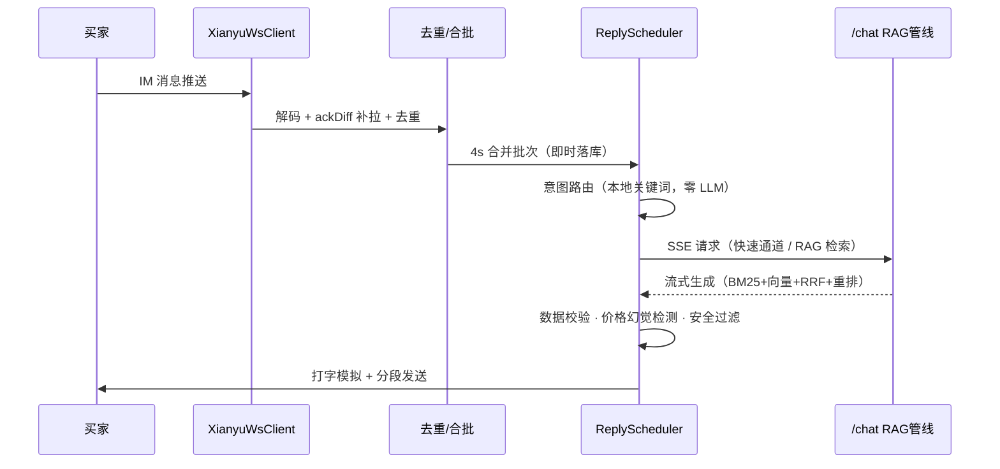
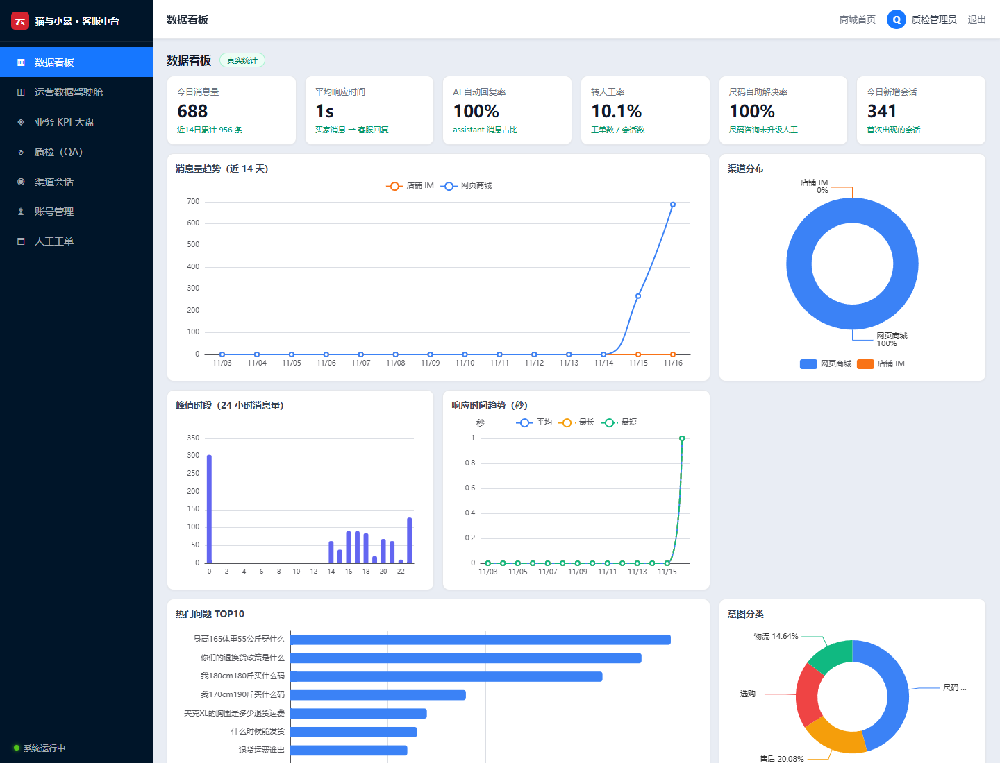
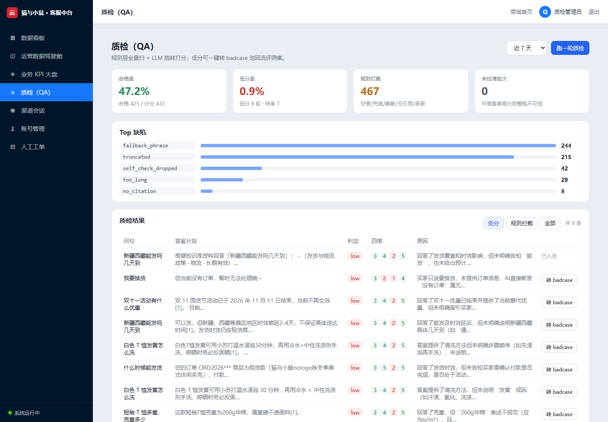

# ShopMate AI · 电商 AI 客服中台

> 多渠道接入 · RAG 应答管线 · 人工坐席工作台 · 知识运营闭环
>
> 不是自动回复脚本，是覆盖 **多渠道接入 → AI 应答 → 人机协同 → 知识运营** 全链路的客服系统。
>
> 当前演示场景：**服饰电商（猫与小鼠 2026AW，9 款在售 / 57 个尺码 SKU）**，主场景为淘宝/抖音店铺客服；知识库 `docs/fashion_kb/`、
> 评测集 `data/evalsets/evalset_v3_fashion.json`（66 条七维评测，含边界/安全/权限 34 条）。本地直跑见 `backend/run_local.sh`、
> `java-platform/run_local.sh`，中间件走 Docker 容器映射端口。

[](https://github.com/wu9506040-lab/shopmate-ai/actions/workflows/ci.yml)
[](https://fastapi.tiangolo.com)
[](https://vuejs.org)
[](https://python.org)
[](https://typescriptlang.org)
[](https://milvus.io)
[](https://mysql.com)
[](https://redis.io)
[](https://docker.com)
[](LICENSE)

---

## 💡 项目定位

**企业级 AI 客服中台**：不是"自动回复脚本"，而是完整覆盖 **多渠道接入 → AI 应答管线 → 人工坐席协同 → 数据看板** 全链路的客服系统。

**主场景是货架电商店铺客服（淘宝 / 抖音小店）**，不是 C2C 个人卖家场景。两者的差别决定了系统的形状：

| 维度 | 货架电商店铺（淘宝/抖店，本项目主场景） | C2C 二手（闲鱼一类） |
|---|---|---|
| 买家诉求 | 尺码、面料、发货、退换、开票 —— 有标准答案，可查可核 | 还价、成色、能否面交 —— 逐单谈判 |
| 价格 | 页面价 + 平台活动，**客服没有任何改价权** | 卖家自己定价，可以谈 |
| 正确性要求 | 答错尺码/政策 = 退换成本与纠纷 | 答错 = 少赚一单 |
| 系统重心 | 检索准确 + 口径一致 + 溯源可查 | 话术灵活 + 谈判节奏 |

因此本项目的技术重心放在**知识检索与口径一致性**（RAG + 引用溯源 + 句级自检 + 质检闭环），
而不是砍价话术生成；`app/services/xianyu/` 是另一类渠道的适配层（验证"渠道可插拔"），
不参与店铺客服主链路，也不提供议价能力。

- **多渠道**：淘宝/抖店店铺客服（主链路）+ 网页商城（Vue3 Web）+ 闲鱼 IM（自研 WebSocket 协议栈，验证私有协议接入）
- **多账号**：一个后台管理 N 个店铺账号，独立连接/独立应答/统一监控
- **人机协同**：AI 自动应答 + 一键接管人工 + 工单闭环 + 外发通知
- **安全兜底**：消息去重/合批、敏感词过滤、回复数据校验（价格幻觉检测）、双 AI 回环防护

## 🏗 架构总览



**一条买家消息的旅程**：



详细分层说明见 [docs/project_overview.md](docs/project_overview.md)。

---

## 📸 界面截图

**数据看板**（ECharts 11 图 · 真实统计：消息趋势 / 渠道分布 / 峰值时段 / 响应时间 / 热门问题 TOP10 / 意图分类）



**质检 QA**（规则全量扫 + LLM 抽样打分 · Top 缺陷分布 · 低分一键回灌 badcase 回流评测集）



---

## ✨ 核心功能

### 1. AI 应答管线
- **三级意图路由**：本地关键词（零 LLM 开销）→ 规则 → LLM 分类
- **分 Agent 话术**：售前/售中/售后场景 YAML 话术库，覆盖尺码、退换、物流、发票
- **回复数据校验**：markdown/占位符剥离、长度保险丝、**价格幻觉检测**（与商品价格白名单对比）
- **安全过滤**：承诺性敏感词拦截、站外引流替换、空回复兜底
- **拟人化**：打字模拟（字数比例延迟）、长回复句界分段、口语短句约束

### 2. 人工协同
- **三栏坐席工作台**：会话列表（未读红点/状态标签）/ 对话窗口（AI·人工·买家三色气泡）/ 客户信息
- **一键接管/恢复**：Redis 命令总线 → daemon 接管态，AI 静默
- **自动建单**：转人工/退款/平台退款申请 → 工单（P0-P2 分级）带订单证据与可读摘要
- **外发通知**：钉钉 / 企业微信 / 飞书 / WxPusher（微信）/ 通用 webhook

### 3. RAG 数据中台
- **多格式入库**：PDF（页眉剔除/章节识别/表格/脚注）/ Markdown / TXT / JSON
- **语义分块**：句子边界切分不截断 + 章节打包 + 尾句重叠
- **渠道隔离**：Milvus expr 过滤，多渠道知识库互不串台
- **增量幂等**：content_hash 去重，重复跑零成本

### 4. 运营管理
- **管理台**：独立登录域 + 深色侧边栏布局（Ant Design Pro 风格）
- **数据看板**：ECharts 消息趋势/渠道分布/响应时间/热门问题/AI 率仪表
- **账号管理**：连接状态灯、启停/重启、注册表热重载

### 5. 质检（QA）
- **两层漏斗**：规则层全量扫确定性缺陷（空答/兜底话/截断/无引用/承诺话术）→ LLM 只抽样打四维分
  （答在点上/依据可查/口径一致/给出下一步），按「意图 × 是否转人工 × 答案长度」分桶抽，长答案多抽
- **批次校准**：每批混入 2 条已知坏答案，坏答案拿高分则整批标记不可信、只留档不进人工队列
- **闭环**：低分一键转 badcase 池（`qa_low` 信号），人工确认后并入评测集，线上问题反哺离线
- **脱敏先行**：送模型前打码手机号/订单号/身份证/邮箱——`messages` 原文没有脱敏，直接外发等于泄露买家信息

### 6. 渠道适配（存量能力）
`app/services/xianyu/` 保留了一套自研 WebSocket 协议栈（LWP 帧 / MessagePack / mtop.h5 签名、
ackDiff 补拉、Cookie 四层自愈），用于验证"渠道可插拔"。**不参与淘宝/抖店店铺客服主链路，
不提供议价能力**——真实场景里客服没有改价权，价格以商品页和平台活动为准。

---

## 🤖 Agent 能力

### 多 Agent 协作制
4 个意图域专家（政策 / 商品 / 订单 / 退款）实现统一 `AgentProtocol`，注册表分派；支持动态转交（转交率有 metrics 观测）与双意图双专家补答——一句话两个问题，两个专家先后作答。

### 受控写操作（human-in-the-loop）
写操作（订单修改、虚拟商品自动发货）不走裸调用：**两步确认 + 审批票据**——票据幂等键绑定完整参数（LLM 重试改参数 = 无票拒绝），交付记录按订单唯一（双层幂等防重复发货），全量审计落 JSONL。门控 fail-closed：校验失败宁可拒绝执行。

### Agent 状态持久化
退款 LangGraph 状态机接入 Checkpointer（SQLite），会话维度 thread——进程中断后从断点续跑，不重复决策；决策历史可回放审计。

### 确定性护栏
货架电商客服没有改价权。回复里的金额逐一对比商品价格白名单，不在白名单即拦截告警；
LLM 只生成话术、不产生价格结论。配合引用校验与兜底话术检测，把"答错口径"挡在发出之前。

### 评测治理
- **四层评测**：330 题召回 hit@k + 60 题话术回归 + 20 组多轮场景
  （`data/evalsets/evalset_multiturn.json`，跑 `scripts/eval_multiturn.py`）+ 20 组跨会话长期记忆
  （`data/evalsets/evalset_longterm.json`，跑 `scripts/eval_longterm.py`，判据看 meta.l3_hits + 查看接口 + 答案）
- **黄金集防篡改**：每题 query+expected 的规范化 sha256 记入 MANIFEST，评测入口强制校验——改动评测集本身即拒绝评测（`scripts/eval_freeze.py`）
- **badcase 回流**：失败案例入独立池，修复验证后隔版本晋级

### 决策可观测
每轮对话落一条结构化 trace（意图路由方法 / 置信度 / 降级 / 缓存命中 / 延迟分段），自动处理率与转人工率可量化（`scripts/agent_metrics.py`）。

## 🔥 核心难点与解决方案

五个真实踩坑并解决的问题——不是功能清单，是"难在哪 → 怎么解 → 结果如何"。

### 1. 私有协议逆向：闲鱼渠道适配（存量能力，非主链路）
- **难在哪**：闲鱼 IM 没有开放 API，推送走钉钉体系 LWP 长连接（`/reg` 注册 + `/r/SyncStatus/ackDiff` 增量同步），payload 是 base64 + MessagePack/JSON 混合编码，发消息还要 mtop.h5 签名——全程零文档，只能抓包逆向。
- **怎么解**：自研 `XianyuWsClient` 完整协议栈：注册握手 / 心跳保活 / ackDiff 消息补拉（轻量通知主动拉全量 + 60s 周期兜底，消息不丢）/ mtop 签名与 Cookie 四层自愈（重签 → HTTP 续期 → Playwright 免密登录 → 人工兜底）。
- **结果**：零第三方 CLI 依赖；`AccountWorker × N` 多账号独立连接/独立应答，断线自动重连。

### 2. 双 AI 回环：自家账号互聊从机制上切断
- **难在哪**：多账号架构下，A 账号 AI 的回复会以"买家消息"形式推到 B 账号——两个 AI 互相触发应答，消息雪球式自增，刷爆 LLM 账单。
- **怎么解**：`AccountManager` 聚合全部自家账号 unb 集合，`AccountWorker` 收到消息先判 `sender ∈ own_set`——自家互发**只落库、不进 AI 管线**。
- **结果**：靠身份判定而非提示词约束，从机制上切断回环，任意多账号拓扑都安全。

### 3. 价格幻觉：LLM 说的每一个金额都要过白名单
- **难在哪**：LLM 综合回答时会编造"新机才 1500"这类幻觉报价——客服场景一次错误报价就是纠纷甚至赔款。
- **怎么解**：`reply_validator` 数据校验管道（markdown/角标/占位符剥离 → 长度保险丝 → 价格校验）：回复中的 `¥` 金额与裸数字金额逐一对比商品价格白名单，不在白名单即拦截告警；价格结论由**商品库白名单**校验，LLM 只生成话术、不产生价格。
- **结果**：价格输出与商品库强一致，幻觉报价进不了买家会话。

### 4. 三层决策：绝大多数消息不花一次 LLM 分类
- **难在哪**：每条消息都过 LLM 分类/检索，成本与延迟双爆炸；纯规则又覆盖不了长尾问法，"全 LLM"与"全规则"都是死路。
- **怎么解**：三级漏斗——**本地分 Agent 关键词**（daemon 侧零 LLM 直达场景话术）→ **规则层**（YAML 意图规则 + 订单号/SKU 实体抽取）→ **LLM 分类兜底**（低温度 + 小模型 + 60 token 预算）。每层的命中分布有独立埋点（`inc_intent_method`），LLM 兜底率可量化。
- **结果**：绝大多数消息在前两层终结，LLM 只为长尾买单；规则命中率直接反映在数据看板上。

### 5. 连发混合意图事故：从线上翻车到三层修复
- **难在哪**（真实线上事故）：买家连发"在吗 / 这个多大 / 多少钱"被合批拼成一条消息——包装文本让规则全部失配，LLM 兜底误判 order_query，匿名买家触发登录校验，回出"用户尚未登录"（2026-10-17 实测）。
- **怎么解**：① 分类前**还原合并包装**——逐条原文跑短路+规则，LLM 只喂干净拼接原文；② 调度层剥掉纯问候前缀、丢弃整条纯问候；③ 合并批"**闲聊让路**"——闲聊命中不再短路整批，实质意图按买家消息顺序收集为多意图，多专家依次补答（"老板在吗"这类问候变体也吞不掉后面的实质问题）。
- **结果**：事故闭环 + 9 条合并批专项回归用例；"线上事故 → 两层修复 → 审计出残余缺口 → 数据化退役条件"全程可讲。

> 完整的问题记录见 [`BUGS.md`](BUGS.md)：61 条真实踩坑（Java 中台 12 条 + AI/RAG 链路 49 条），
> 每条都是「现象 → 根因 → 修复 → 验证」，开头有面试速查索引（按考点和推荐度排序）。
> 上面这 5 条是其中最能讲完整故事的部分，BUGS.md 里还有评测器假绿、句级自检误杀订单号、
> 资料截断导致依据跨行取数、提示词过度提醒反而变差等更细的坑。


## 🛠 技术栈

| 层 | 技术 |
|----|------|
| 前端 | Vue3 + Vite + TypeScript、ECharts、Nginx |
| 后端 | Python 3.11、FastAPI（SSE 流式）、SQLAlchemy、Pydantic |
| 实时通信 | SSE 流式（主链路）；websockets + MessagePack（闲鱼存量适配，非主链路） |
| 数据 | MySQL 8（消息/工单，account 列隔离）、Redis（热历史/命令总线） |
| 向量库 | Milvus（text-embedding-v3 1024 维 + BM25/RRF 混合检索 + 重排；门面模式可切 Milvus） |
| LLM | 通义千问 qwen-plus（SSE 流式） |
| 浏览器自动化 | Playwright（Cookie 免密登录刷新） |
| 部署 | Docker Compose（6 容器）+ watchdog 进程守护 |

---

## 🚀 快速开始

```bash
# 1. 克隆
git clone git@github.com:wu9506040-lab/shopmate-ai.git
cd shopmate-ai

# 2. 配置环境变量
cp deploy/.env.example deploy/.env.dev
#    填入：MYSQL 密码 / QWEN_API_KEY（通义千问）

# 3. 启动基础设施（MySQL/Redis/Milvus/API/Nginx 六容器）
cd deploy && docker compose up -d && cd ..

# 4. 前端构建（bind-mount 到 nginx 容器）
cd frontend && npm install && npm run build && cd ..

# 5. 初始化数据表 + 知识库
mysql -h 127.0.0.1 -P 3307 -u cs_user -p customer_service < deploy/mysql/init/01_schema.sql
python scripts/ingest_kb.py

# 6. 闲鱼账号接入（可选）
#    配置登录态：cookie.txt（项目根目录，含登录 Cookie），支持
#    四级自愈（重签 → 续期 → 浏览器自动刷新 → 人工介入）
#    多账号：编辑 backend/config/accounts.json（参考 accounts.example.json）

# 7. 启动 daemon + 看门狗
python scripts/run_xianyu_daemon.py &
python scripts/watchdog_xianyu_daemon.py &

# 访问
#   商城：        http://localhost:5173
#   人工后台：    http://localhost:5173/admin/xianyu （管理员登录）
#   数据看板：    http://localhost:5173/admin/board
#   API 文档：    http://localhost:8000/docs
```

> ⚠️ **安全提示**：`cookie.txt`、`cookies/`、`backend/config/accounts.json`、`notify.json` 均含敏感凭据，已加入 `.gitignore`，仓库只保留 `*.example.json` 模板。

---

## 📊 项目规模

| 指标 | 数值 |
|------|------|
| 测试 | 1,225 passed / 0 failed（pytest 实测口径，2026-10-24） |
| 评测 | 四层：330 题召回 + 60 题话术 + 20 组多轮 + 20 组跨会话记忆（评测集均已入库）；服饰域七维 66 题（含边界/安全/权限 34 条） |
| Function Call 工具 | 19 个（含虚拟商品自动发货） |
| Git 提交 | 340+（活跃开发中） |
| 端到端延迟 | 54s → 8-15s（分阶段优化，全程日志拆解） |

---

## 📄 License

MIT
